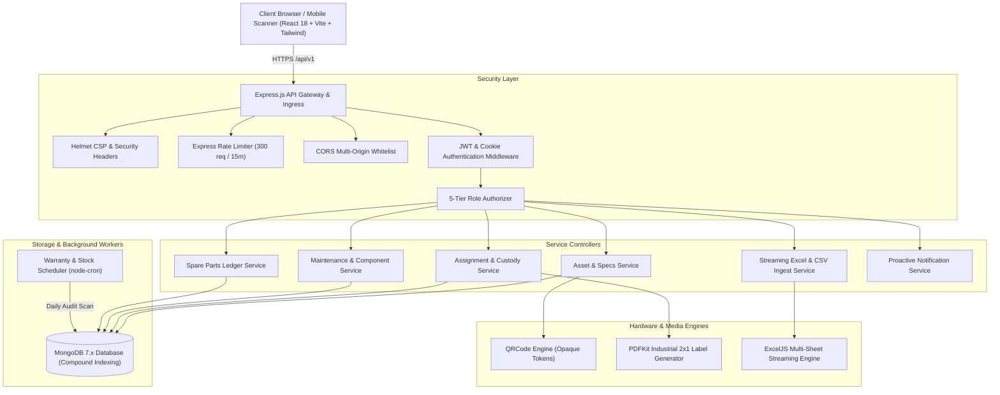

# AssetTrack — System Architecture & Topology

## 1. Architectural Overview

AssetTrack is engineered as a decoupled, multi-tenant enterprise ITAM platform adhering to Clean Architecture and Domain-Driven Design principles.

---

## 2. Layered Request Flow

1. **Ingress & Security Layer:**
   - Every request enters through `server/src/app.js`.
   - Security headers applied via `helmet()`.
   - Global rate limiter throttles burst traffic (bypassed in test environment).
   - Strict CORS policy validates caller origin against `CLIENT_URL`.
   - Body parsers accept JSON and URL-encoded bodies up to 15MB.

2. **Authentication & Tenant Scoping:**
   - The `protect` middleware verifies the Bearer JWT or HttpOnly signed cookie.
   - Extracts `req.user` with `id`, `organizationId`, and `role`.
   - All subsequent Mongoose queries are strictly bounded by `{ organizationId: req.user.organizationId }` (DEC-007).

3. **Validation Boundary:**
   - Every mutating request is intercepted by a Zod schema validator (`authValidator.js`, `assetValidator.js`, `assignmentValidator.js`, `maintenanceStockValidator.js`).
   - Prevents NoSQL operator injection (e.g. `{ $gt: '' }`), type mismatches, and boundary overflows before touching database models.

4. **Domain Services & Transactions:**
   - Pure business logic sits inside isolated service modules (`assetService.js`, `assignmentService.js`, `maintenanceService.js`, `stockLedgerService.js`).
   - Atomic state transitions update both hardware specifications and consumables inventory within unified database updates.

5. **Streaming & Media Generation:**
   - **Vector Labels:** `pdfLabelGenerator.js` creates an exact 2x1 inch PDF on the fly using `pdfkit`, drawing borders, vector typography, and high-density QR graphics without writing temporary files to disk.
   - **Excel Workbooks:** `exportService.js` constructs formatted 4-tab workbooks (Summary, Hardware Inventory, Active Custody, Spare Parts Ledger) and streams the binary spreadsheet directly to the HTTP response.

---

## 3. Core Architectural Decisions

- **DEC-001 (Unified Monorepo):** Colocated `server` and `client` directories with decoupled `package.json` configurations to ensure shared types and simplified deployment.
- **DEC-002 (Integer Minor Currency Units):** All acquisition prices, unit costs, and repair expenditures are stored as integers in minor units (paise / cents) to completely eliminate floating-point calculation errors.
- **DEC-003 (Immutable Chain of Custody):** Prior assignments are never mutated or overwritten upon return; instead, a new historical record is preserved with transition timestamps and return inspection checklists.
- **DEC-004 (Opaque QR Token Integrity):** QR labels never expose database internal IDs, MAC addresses, or employee names on physical stickers. Instead, a 128-bit random opaque cryptographic token is stored and resolved through authenticated backend lookups.
- **DEC-005 (Atomic Component Evolution):** When hardware parts (RAM, SSD, GPU) are upgraded or replaced during maintenance, the spare parts ledger is automatically decremented and the asset specifications are immediately synchronized.
- **DEC-006 (Non-Negative Stock Guard):** Spare parts inventory levels are guarded with Mongoose `min: 0` constraints and atomic conditional updates, preventing inventory underflows.
- **DEC-007 (Hard Tenant Partitioning):** Compound unique indexes like `{ organizationId: 1, assetTag: 1 }` and `{ organizationId: 1, serialNumber: 1 }` ensure isolation across organizations.
