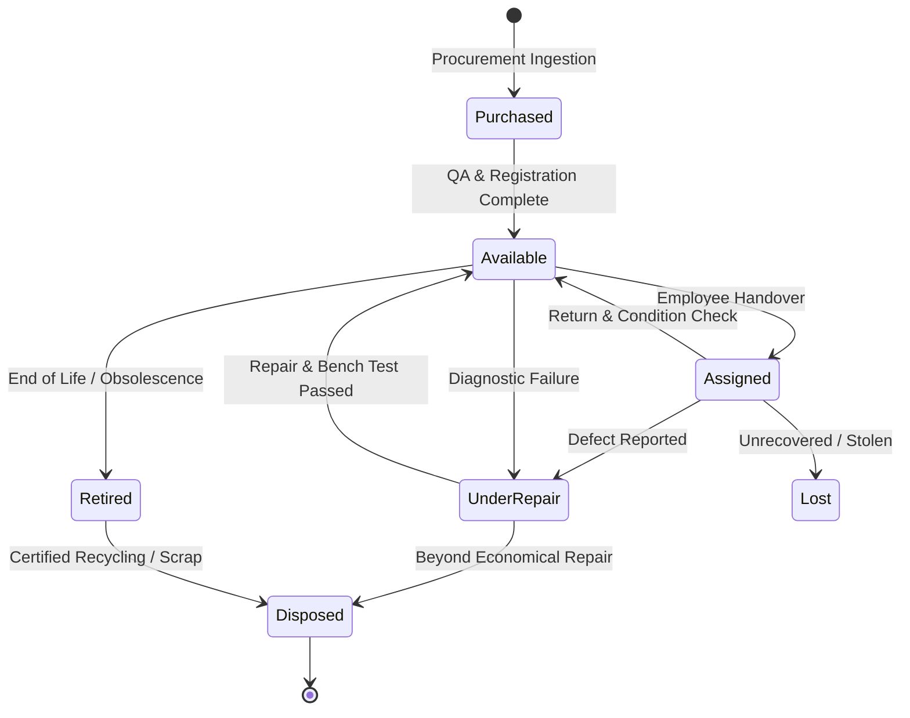

# AssetTrack — Asset Lifecycle & Controlled State Transitions

AssetTrack enforces a deterministic Finite State Machine (FSM) governing asset status changes. Arbitrary or illegal state skips are prohibited.

---

## 1. Lifecycle State Machine Diagram

---

## 2. Valid State Transitions

| Origin Status | Permitted Destination Statuses | Required Business Action |
| :--- | :--- | :--- |
| **Purchased** | `Available`, `Retired` | Asset tagging, QR generation, location placement |
| **Available** | `Assigned`, `Under Repair`, `Retired` | Handover creation, maintenance ticket, EOL decommission |
| **Assigned** | `Available`, `Under Repair`, `Lost` | Return inspection, diagnostic triage, police/incident report |
| **Under Repair** | `Available`, `Retired`, `Disposed` | Repair signoff, component evolution, salvage scrap |
| **Retired** | `Disposed` | IT asset disposition (ITAD) certificate |
| **Lost** | `Available`, `Disposed` | Asset recovery or write-off |
| **Disposed** | *(Terminal)* | Immutable record preserved; no further transitions allowed |

---

## 3. Transition Guards & Invariants

1. **Double-Booking Invariant:** An asset cannot be assigned to an employee if its status is not `Available`. Attempting to assign an `Assigned`, `Under Repair`, or `Retired` asset returns HTTP `400 Bad Request`.
2. **Clear Custody Guard:** Mutating an asset status to `Available` automatically clears `assignedTo = null` and updates the active `AssetAssignment` record to `Returned`.
3. **Repair Auto-Lock:** Initiating a maintenance ticket automatically transitions the target asset to `Under Repair` and unassigns any active deployment.
4. **Disposal Immutability:** Once marked `Disposed`, an asset cannot be assigned, placed under repair, or modified.
