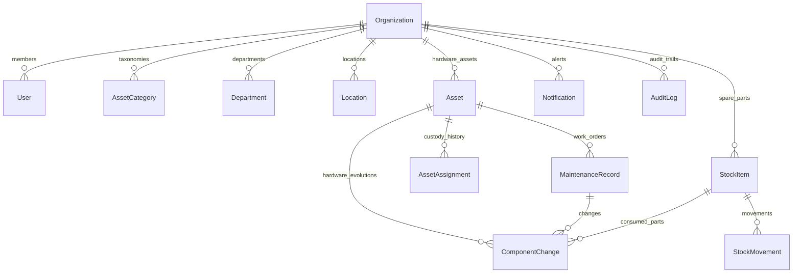

# AssetTrack — Database Schema & Data Models

AssetTrack utilizes MongoDB with Mongoose ODM. All entity collections are isolated by tenant via `organizationId`.

---

## 1. Core Collections

### 1.1 `organizations`
Tenant boundary container.
- `_id`: ObjectId
- `name`: String (required, e.g. "Acme Corp")
- `code`: String (required, unique uppercase, e.g. "ACME")
- `assetTagPrefix`: String (required, uppercase, e.g. "ACM")
- `isActive`: Boolean (default: true)
- `settings`: Object (fiscalYearStart, currencyCode, labelDimensions)
- `createdAt`, `updatedAt`: Timestamps

### 1.2 `users`
Authenticated organizational users with 5-tier RBAC.
- `_id`: ObjectId
- `organizationId`: ObjectId -> `organizations` (required, index)
- `name`: String (required)
- `email`: String (required, lowercase, trim)
- `passwordHash`: String (bcrypt, salt rounds: 12)
- `role`: Enum `['Admin', 'Asset Manager', 'Technician', 'Employee', 'Auditor']`
- `employeeId`: String (unique within organization)
- `departmentId`: ObjectId -> `departments`
- `isActive`: Boolean (default: true)
- **Indexes:** `{ organizationId: 1, email: 1 }` (unique), `{ organizationId: 1, employeeId: 1 }` (unique, sparse)

### 1.3 `assets`
Primary hardware registry with nested deep specifications.
- `_id`: ObjectId
- `organizationId`: ObjectId -> `organizations` (required, index)
- `assetTag`: String (required, unique within org, e.g. "ACM-AST-0001")
- `qrCodeReference`: String (required, unique cryptographic opaque token)
- `name`: String (required, e.g. "MacBook Pro 16")
- `categoryId`: ObjectId -> `asset_categories` (required)
- `manufacturer`: String (required)
- `model`: String (required)
- `serialNumber`: String (required, unique within org)
- `status`: Enum `['Purchased', 'Available', 'Assigned', 'Under Repair', 'Retired', 'Disposed']`
- `condition`: Enum `['New', 'Excellent', 'Good', 'Fair', 'Poor']`
- `locationId`: ObjectId -> `locations` (required)
- `departmentId`: ObjectId -> `departments` (required)
- `assignedTo`: ObjectId -> `users` (nullable)
- `purchaseCostMinor`: Number (integer paise, default: 0)
- `warrantyExpiry`: Date (indexed)
- `specifications`: Object
  - `cpu`: `{ manufacturer, model, generation, cores, threads, baseClockGhz, boostClockGhz }`
  - `ram`: `{ totalCapacityGb, ddrGeneration, moduleType, slotCount, modules: [{ slot, capacityGb, speedMts, make }] }`
  - `storage`: `[{ driveNumber, driveType, capacityGb, manufacturer, model, serialNumber }]`
  - `gpu`: `{ isDedicated, manufacturer, model, vramGb }`
  - `motherboard`: `{ manufacturer, model, chipset, socket }`
  - `networking`: `{ ethernetMac, wifiMac, ipAddress, macAddress }`
  - `operatingSystem`: `{ name, edition, version, architecture, buildNumber }`
- **Indexes:** `{ organizationId: 1, assetTag: 1 }` (unique), `{ organizationId: 1, serialNumber: 1 }` (unique), `{ qrCodeReference: 1 }` (unique), `{ organizationId: 1, status: 1 }`, `{ organizationId: 1, warrantyExpiry: 1 }`

### 1.4 `asset_assignments`
Immutable chain of custody records.
- `_id`: ObjectId
- `organizationId`: ObjectId -> `organizations` (required, index)
- `assetId`: ObjectId -> `assets` (required, index)
- `employeeId`: ObjectId -> `users` (required, index)
- `assignedAt`: Date (required, default: Date.now)
- `assignedBy`: ObjectId -> `users` (required)
- `expectedReturnDate`: Date
- `returnedAt`: Date (nullable)
- `conditionAtHandover`: Enum `['New', 'Excellent', 'Good', 'Fair']`
- `conditionAtReturn`: Enum `['Excellent', 'Good', 'Fair', 'Poor', 'Damaged']`
- `accessories`: `[{ name, verified }]`
- `status`: Enum `['Active', 'Returned', 'Transferred']`
- `notes`: String
- **Indexes:** `{ organizationId: 1, assetId: 1, status: 1 }`, `{ organizationId: 1, employeeId: 1, status: 1 }`

### 1.5 `stock_items`
Spare parts and consumables catalog.
- `_id`: ObjectId
- `organizationId`: ObjectId -> `organizations` (required, index)
- `itemCode`: String (required, uppercase, unique within org)
- `name`: String (required)
- `category`: Enum `['RAM', 'SSD', 'HDD', 'Cables', 'Thermal Paste', 'Power Supply', 'Peripherals', 'Other']`
- `unit`: String (default: "pcs")
- `currentQuantity`: Number (min: 0, default: 0)
- `minStockLevel`: Number (default: 5)
- `unitCostMinor`: Number (integer paise)
- `location`: String
- **Indexes:** `{ organizationId: 1, itemCode: 1 }` (unique), `{ organizationId: 1, currentQuantity: 1 }`

### 1.6 `stock_movements`
Ledger of all stock receipts, issuances, and audit adjustments.
- `_id`: ObjectId
- `organizationId`: ObjectId -> `organizations` (required, index)
- `stockItemId`: ObjectId -> `stock_items` (required, index)
- `movementType`: Enum `['IN', 'OUT', 'ADJUST']`
- `quantity`: Number (required, min: 1)
- `unitCostMinor`: Number (integer paise)
- `balanceAfter`: Number (required, min: 0)
- `referenceNumber`: String (PO number, Work Order #)
- `performedBy`: ObjectId -> `users` (required)
- `notes`: String
- **Indexes:** `{ organizationId: 1, stockItemId: 1, createdAt: -1 }`

### 1.7 `maintenance_records`
Hardware diagnosis and work order tickets.
- `_id`: ObjectId
- `organizationId`: ObjectId -> `organizations` (required, index)
- `assetId`: ObjectId -> `assets` (required, index)
- `ticketNumber`: String (required, unique within org, e.g. "MNT-2026-0001")
- `issueDescription`: String (required)
- `priority`: Enum `['Low', 'Medium', 'High', 'Critical']`
- `status`: Enum `['Open', 'In Progress', 'Awaiting Parts', 'Completed', 'Cancelled']`
- `category`: String
- `assignedTechnicianId`: ObjectId -> `users`
- `diagnosis`: String
- `actionTaken`: String
- `costMinor`: Number (integer paise)
- `completedAt`: Date
- **Indexes:** `{ organizationId: 1, ticketNumber: 1 }` (unique), `{ organizationId: 1, status: 1 }`

### 1.8 `component_changes`
Hardware component evolution log.
- `_id`: ObjectId
- `organizationId`: ObjectId -> `organizations` (required, index)
- `assetId`: ObjectId -> `assets` (required, index)
- `maintenanceId`: ObjectId -> `maintenance_records`
- `componentType`: Enum `['CPU', 'RAM', 'SSD', 'HDD', 'GPU', 'Motherboard', 'Power Supply', 'Other']`
- `action`: Enum `['Upgrade', 'Replace Faulty', 'Add', 'Remove']`
- `oldComponentDetails`: String
- `newComponentDetails`: String
- `consumedStockItemId`: ObjectId -> `stock_items`
- `costMinor`: Number
- `technicianId`: ObjectId -> `users`
- `reason`: String
- `notes`: String

### 1.9 `notifications`
In-app proactive hardware and inventory warning alerts.
- `_id`: ObjectId
- `organizationId`: ObjectId -> `organizations` (required, index)
- `title`: String (required)
- `message`: String (required)
- `type`: Enum `['Warranty Expiry', 'Low Stock', 'Overdue Return', 'Maintenance Alert', 'General']`
- `entityType`: Enum `['Asset', 'StockItem', 'AssetAssignment', 'MaintenanceRecord']`
- `entityId`: ObjectId
- `isRead`: Boolean (default: false)
- `targetRoles`: `[String]` (e.g. `['Admin', 'Asset Manager']`)
- **Indexes:** `{ organizationId: 1, isRead: 1, createdAt: -1 }`
